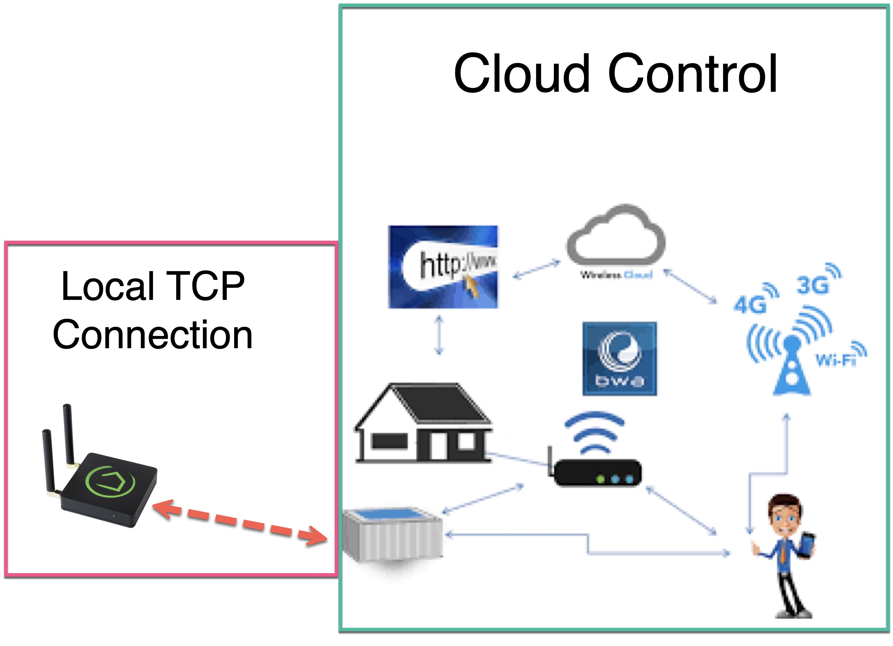
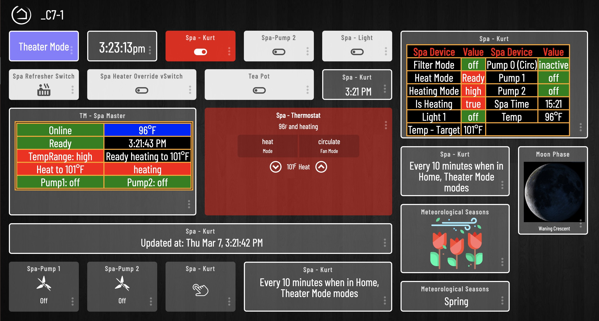
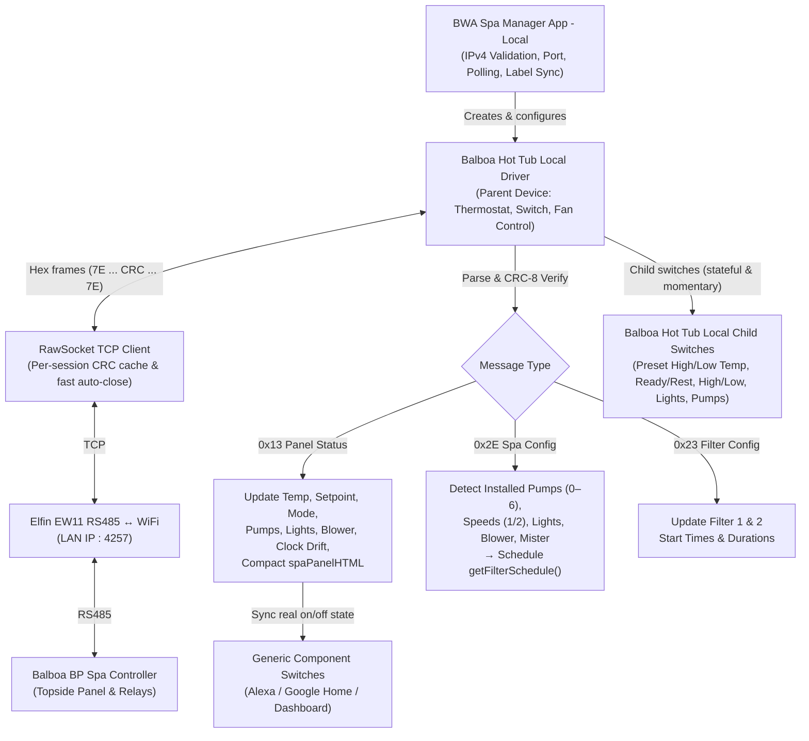

# HB BWA Spa Manager (Direct Local TCP & Legacy Cloud Control)

 Forked from [richardpowellus/HBBWASpaManager](https://github.com/richardpowellus/HBBWASpaManager)

* [Change-log & Version Release Features](https://github.com/KurtSanders/HBBWASpaManager/wiki/Features-by-Version)
* [Hubitat Community Support Thread](https://community.hubitat.com/t/release-bwa-spamanager-cloud-control-direct-local-tcp/151421)

*Dashboard and Tiles shown above customized with [Tile Master by BPTWorld](https://community.hubitat.com/t/release-tile-master-display-multiple-devices-that-can-be-controlled-from-the-tile/23140).*

---

## Key Features

- ### **Local Control**

  * **100% Local TCP Control (No Cloud Required):** Communicates directly with your Balboa BP-series spa over your LAN using an **Elfin EW11 RS485-to-WiFi** adapter (or Balboa WiFi module on port `4257`).

  * **Fast Poll & Auto-Close (~0.5s):** Routine `refresh()` polls close the TCP socket immediately after receiving and validating the first fresh `Panel Status Update` (`0x13`) frame, minimizing socket hold time and hub overhead.
    * **Real-Time Child Switch Sync (Alexa / Google Home / Dashboards):**
      * `Generic Component Switch` child devices (`Pump1`–`Pump6`, `Light1`–`Light2`) reflect the spa's actual live state and handle multi-speed pump cycling (`Off` / `Low` / `High`) idempotently.
      * Stateful **Spa Preset Temp (High/Low)** child switch backed by `presetTempHigh` (default `102`) and `presetTempLow` (default `80`) preferences—toggles the spa's target temperature between High (**ON**) and Low (**OFF**) and stays synced with live setpoint updates.
      * Optional momentary `Balboa Hot Tub Local Child Switch` devices for quick Dashboard tiles, Rule Machine, and WebCore triggers (`Refresh`, `Ready`/`Rest`, `High`/`Low` range, `Lights`, `Pumps`).

  * **Full °F and °C Support:** Proper Celsius range validation (`10.0–26.5°C` low, `26.5–40.0°C` high) and `0.5°C` Balboa protocol encoding.

  * **Filter Cycle & Clock Management:** Polls filter cycle schedules (`Filter1Start`, `Filter1Duration`, `Filter2Start`, `Filter2Duration`, `isFilter2Active`) and offers optional **Auto-Sync Spa Clock** when drift exceeds a configurable threshold.

  * **Low Hub Overhead:** Deduplicates unchanged attribute events (`makeEvent`) and caches the dashboard CSS file locally on the hub while keeping `spaPanelHTML` compact under Hubitat's 1024-byte limit.

- ### Cloud Control

  - Unsupported Legacy Application

---

## Architecture & Data Flow (Local)

---

## Requirements (Local)

* Balboa BP-series spa equipped with one of the following:
  * **[Elfin EW11 RS485-to-WiFi](https://community.hubitat.com/t/release-new-bwa-spa-manager-cloud-control-direct-local-tcp/151421)** *(Recommended — economical, local-only, and configurable via web UI)*
  * **[Balboa Cloud Spa Controller (50350)](https://www.amazon.com/dp/B0C89NLVCW)** *(for Legacy Cloud Control)*
* **[Hubitat Elevation Hub](https://hubitat.com/)**
* **[Hubitat Package Manager (HPM)](https://hubitatpackagemanager.hubitatcommunity.com/)** *(Recommended for installation & updates)*

---

## Installation & Setup

### Local Control by TCP (Recommended)

1. Install **[Hubitat Package Manager (HPM)](https://hubitatpackagemanager.hubitatcommunity.com/)** on your Hubitat hub.
2. In HPM, select **Install** and search for **BWA Spa Manager - Local Control** (or install the app, driver, child switch driver, and `Balboa-Hot-Tub-API-Library` + `SanderSoft-Library` manually).
3. On your Hubitat hub, go to **Apps → Add User App** and select **BWA Spa Manager App - Local**.
   * The app automatically creates the `Balboa Hot Tub Local Driver` parent device for you—do **not** manually create a separate virtual device.
4. Enter your spa's static **Local IP address**, **TCP Port** (default `4257`), **Auto Polling Interval**, and whether to create momentary child switches, then click **Done**.
5. Open the created parent device (`Balboa Hot Tub Local Driver`) and click **Configure** (this discovers your installed pumps/lights and schedules `getFilterSchedule`), then click **Refresh**.
6. *(Optional for Alexa / Google Home)* Click **Create Child Devices** on the parent device to generate stateful `Generic Component Switch` devices for each installed pump and light.

### Cloud Control (Unsupported Legacy)

*Uses Balboa's Cloud Server API.*

1. Connect your spa using the **BWA Cloud Spa Controller** and verify connectivity in the *BWA Spa Control* iOS/Android app.
2. In HPM, search for **BWA Spa Manager - Cloud Control**, install, and configure the app with your BWA credentials.
3. Separate child devices will be created automatically for your spa's temperature, pumps, lights, and modes.

---

## HPM Install & Upgrade FAQs

* **New Installs:** Installing via HPM is strongly recommended. Search for **BWA Spa Manager** and select the **Local Control** package.
* **Upgrading from Older Versions:** If HPM reports duplicate drivers or libraries from an earlier version:
  1. Use HPM → **Package Manager Settings** → **Un-Match a Package** to clear cached package state if uninstall fails.
  2. Check **Apps Code**, **Drivers Code**, and **Libraries Code** on your hub and remove any residual files from older versions.
  3. Re-install cleanly via HPM.
